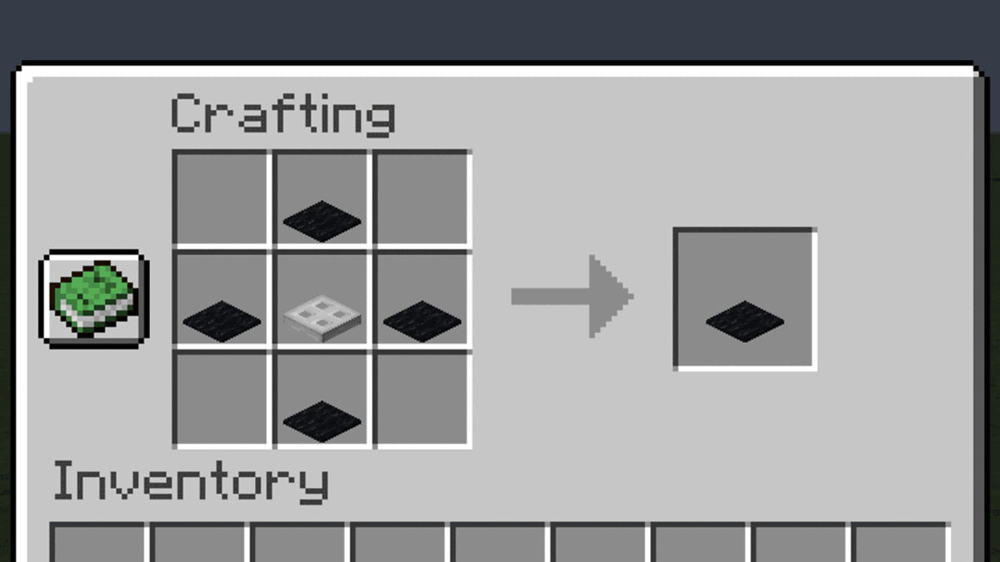
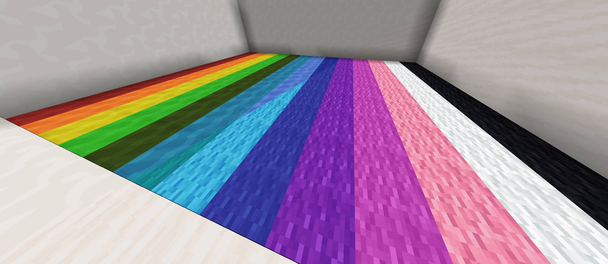
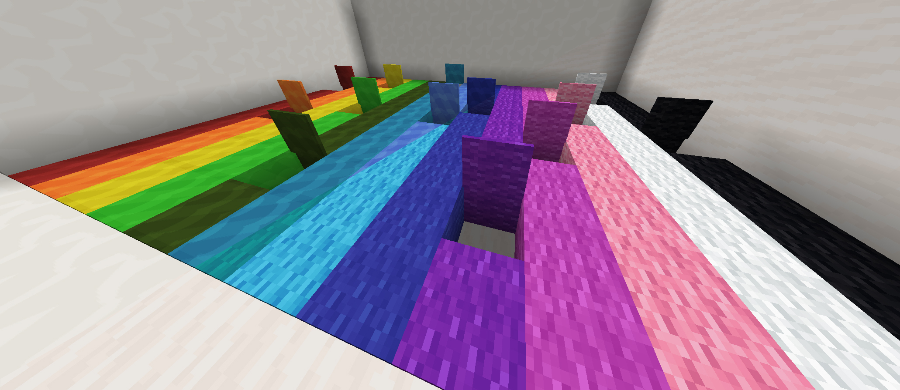

# Carpet Trapdoors

Simple mod that disguises wooden, iron and copper trapdoors as carpets.

All trapdoors still behave like vanilla trapdoors with all functionality. The recipe accepts every
type of wooden trapdoor, the iron trapdoor, every copper trapdoor (any oxidation, waxed or not)
and every carpet, including moss.



Full resource pack support:




## Supported versions

| Minecraft | Branch    | Loaders                                             |
|-----------|-----------|-----------------------------------------------------|
| 26.3      | `26.3`    | Fabric, NeoForge, Forge                             |
| 1.21.11   | `1.21.11` | Fabric, NeoForge, Forge                             |
| 1.21.1    | `1.21.1`  | Fabric, NeoForge, Forge                             |
| 1.20.1    | `1.20.1`  | Fabric, Forge (the Forge file also runs on NeoForge) |
| 1.19.2    | `1.19.2`  | Fabric, Forge                                       |
| 1.18.2    | `1.18.2`  | Fabric, Forge                                       |

Copper carpet trapdoors need Minecraft 1.21 or newer.

## Development

One repository builds the mod for **Fabric, NeoForge and Forge**. Each Minecraft version lives on
its own branch (`1.20.1`, `1.21.1`, …).

| Module      | Contents                                                                     |
|-------------|------------------------------------------------------------------------------|
| `common/`   | The block, the list of all variants, the creative tab and all resources      |
| `fabric/`   | Fabric entry point (registration only)                                        |
| `neoforge/` | NeoForge entry point and the data generators                                  |
| `forge/`    | Forge entry point (registration only)                                         |

Useful commands (JDK 21 required):

```
./gradlew build                # builds all three jars into <loader>/build/libs
./gradlew :neoforge:runData    # regenerates common/src/generated/resources
./gradlew :fabric:runClient    # or :neoforge:runClient / :forge:runClient
```

Block states, models, recipes, loot tables, tags and translations are **generated** – never edit
`common/src/generated` by hand. To add a colour or trapdoor type, extend the enums in
`common/src/main/java/at/mueseb/carpettrapdoors/CarpetTrapdoors.java` and run `runData`.

### Porting to a new Minecraft version

1. `git checkout -b <new version>` from the newest branch.
2. Update `gradle.properties` (versions are listed in the comments there).
3. Fix compile errors, run `./gradlew :neoforge:runData`, then `./gradlew build`.
4. Later fixes are made on the oldest affected branch and merged forward.

The build setup is based on [MultiLoader-Template](https://github.com/jaredlll08/MultiLoader-Template).
